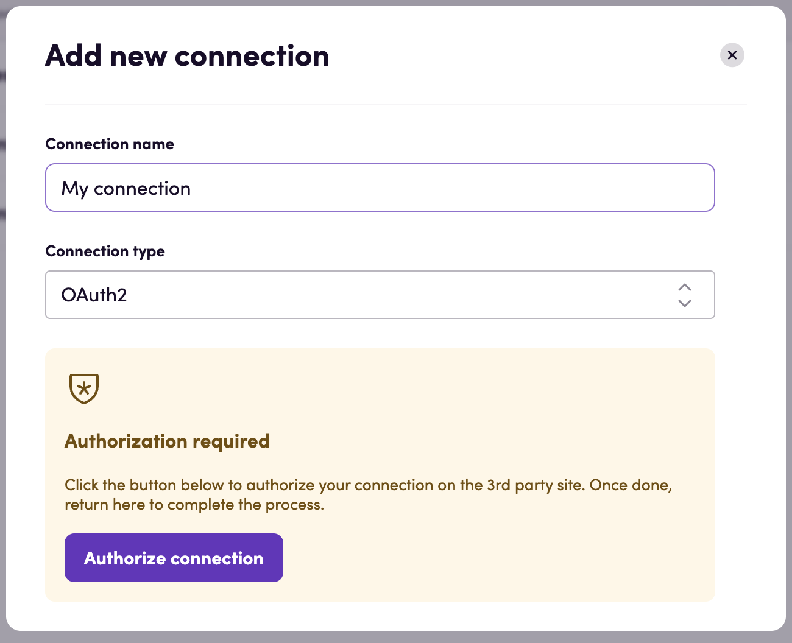
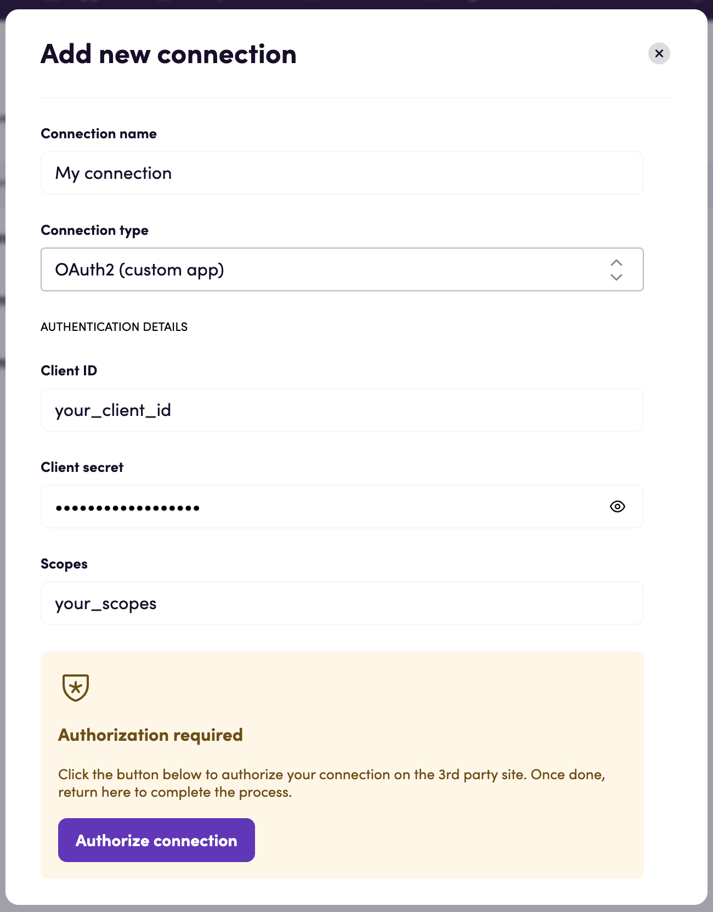
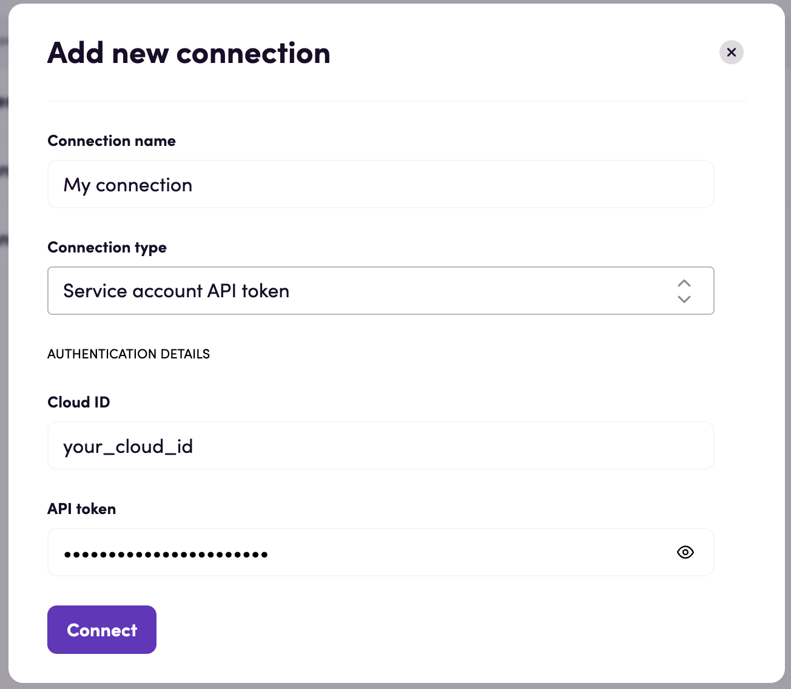

# Blackbird.io Confluence

Blackbird is the new automation backbone for the language technology industry. Blackbird provides enterprise-scale automation and orchestration with a simple no-code/low-code platform. Blackbird enables ambitious organizations to identify, vet and automate as many processes as possible. Not just localization workflows, but any business and IT process. This repository represents an application that is deployable on Blackbird and usable inside the workflow editor.

## Introduction

<!-- begin docs -->

Create, collaborate, and organize all your work in one place. Confluence is a team workspace where knowledge and collaboration meet. Dynamic pages give your team a place to create, capture, and collaborate on any project or idea.

## Before setting up

You must ensure that you have a Confluence account and access to it. 
During authentication, you will be redirected to the Confluence login page to authorize the app. 
Note, this app leverages the [Confluence Cloud REST API](https://developer.atlassian.com/cloud/confluence/rest/v1/intro/#about) to provide a streamlined experience for managing your content.

### Custom scopes

You can connect with your own OAuth2 app or with a service account API token. Both need Confluence scopes and the full list our app supports is in [Supported scopes](#supported-scopes) below.

#### Custom OAuth2 app

- Go to [Atlassian Developer Console](https://developer.atlassian.com/console/myapps/).
- Click _Create_ > _OAuth 2.0 Integration_.
- Name your app for future reference, read and agree to be bound by Atlassian's developer terms and click _Create_.
- Go to _Authorization_ and click _Add_ for the OAuth 2.0 (3LO) authorization type.
- In the _Callback URLs_ field, specify `https://bridge.blackbird.io/api/AuthorizationCode` and click _Save changes_.
- Go to _Permissions_, find _Confluence API_ and click _Add_.
- Click _Configure_ and set the scopes from [Supported scopes](#supported-scopes).
- Go to _Settings_ > _Authentication details_ and copy the `Client ID` and `Secret` values.

#### Service account API token

- Go to [Atlassian Administration](https://admin.atlassian.com/) and select your organization.
- Go to _Directory_ > _Service accounts_ and select the service account you want to use (or create one).
- Click _Create credentials_, select _API token_ and click _Next_.
- Enter a name and an expiration date, then click _Next_.
- Select the scopes from [Supported scopes](#supported-scopes), then click _Next_ > _Create_.
- Copy the token right away. You won't be able to see it again.
- Get your Cloud ID from `https://<your-site>.atlassian.net/_edge/tenant_info` (the `cloudId` value).

> Token scopes can't be changed after creation. If an action fails with `401 Unauthorized; scope does not match`, create a new token with the missing scopes.

#### Supported scopes

- Classic: `write:confluence-content read:confluence-space.summary write:confluence-space
  write:confluence-file write:confluence-props read:confluence-props manage:confluence-configuration read:confluence-content.all
  read:confluence-content.summary search:confluence read:confluence-content.permission read:confluence-user
  read:confluence-groups write:confluence-groups`
- Granular: `read:content:confluence write:content:confluence read:content-details:confluence
  read:space-details:confluence delete:content:confluence read:page:confluence write:page:confluence delete:page:confluence
  read:attachment:confluence read:custom-content:confluence write:custom-content:confluence delete:custom-content:confluence
  write:comment:confluence delete:comment:confluence read:template:confluence write:template:confluence
  read:space:confluence read:content.permission:confluence read:content.property:confluence write:content.property:confluence`

If you don't need to limit scopes, just copy and paste all of the above.

## Connecting

Navigate to Apps search for **Confluence**. Click _Add Connection_ and name it for future reference e.g. 'My connection'.

### OAuth2

1. Select the _OAuth2_ connection type from the dropdown.
2. Click _Authorize connection_.
3. Follow the instructions that Confluence gives you.
4. Confirm that the connection has appeared and the status is _Connected_.

### OAuth2 (custom app)

1. Select the _OAuth2 (custom app)_ connection type from the dropdown.
2. Fill in _Client ID_, _Client secret_ and _Scopes_ that you obtained before.
3. Click _Authorize connection_.
4. Follow the instructions that Confluence gives you.
5. Confirm that the connection has appeared and the status is _Connected_.

### Service account API token

1. Select the _Service account API token_ connection type from the dropdown.
2. Fill in _Cloud ID_ and _API token_ that you obtained before.
3. Click _Connect_.

## Actions

### Content

- **Search content** - Returns a list of content that matches the search criteria.
- **Get content** - Returns a single content object specified by the content ID.
- **Get content as HTML** - Returns a single content HTML specified by the content ID.
- **Update content from HTML** - Updates a content from HTML file.
- **Create content from HTML** - Creates a content from HTML file.
- **Create content** - Creates a new content with specified data.
- **Delete content** - Deletes a content specified by the content ID.

### Pages

- **Download page** - Downloads a Confluence page as HTML file.

### Page proeprties

- **Search page properties** - Lists page properties.
- **Get page property** - Gets a specific page property.
- **Set page property** - Creates or updates a page property.

## Events

- **On content created** - Triggered when content is created or existing content is updated.
- **On content updated** - Triggered when existing content is updated.

## Error handling

Our app returns errors in a structured format. Below are the typical error responses you might encounter:

`Status code: {Status code}, Message: {Message}`

- Status code: The HTTP status code associated with the error.
- Message: A brief message describing the error which we get from the Confluence API.

If you encounter an error, please try to resolve it using the information provided in the error message. If you are unable to resolve the error, please contact us for further assistance.

## Feedback

Do you want to use this app or do you have feedback on our implementation? Reach out to us using the [established channels](https://www.blackbird.io/) or create an issue.

<!-- end docs -->
